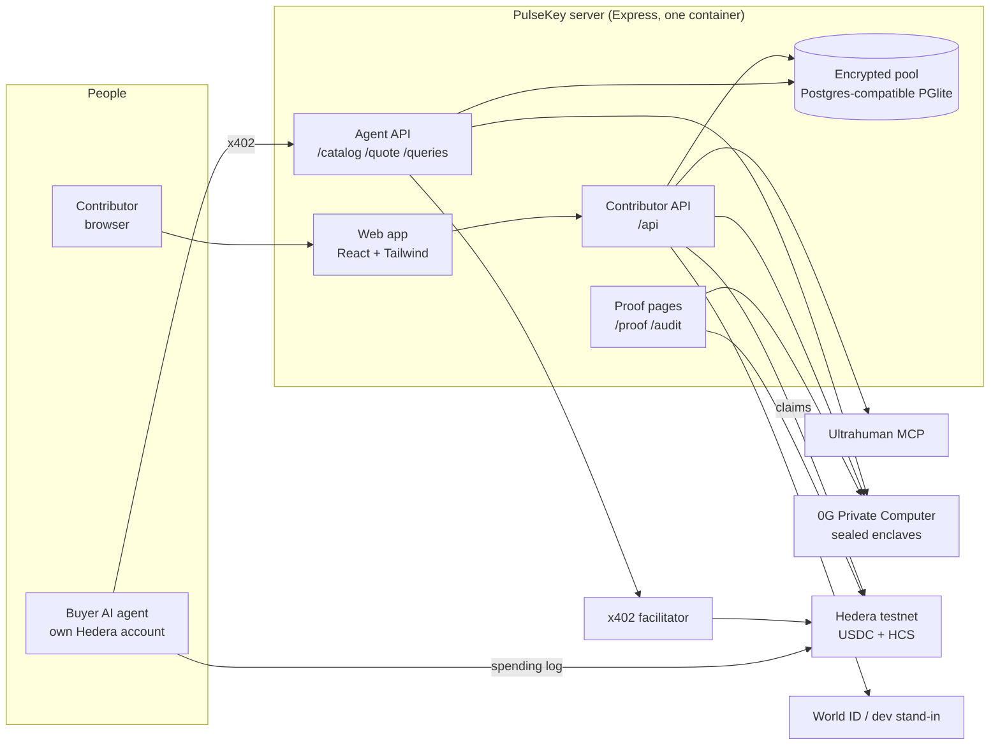

# PulseKey

**Your ring tracks your sleep. Now your sleep pays you.**

PulseKey is a private pool of sleep and recovery data from Ultrahuman rings. AI agents pay per answer, in USDC over x402 on Hedera, for **group answers** about many people. They never get anyone's nights. Everyone counted in an answer is paid, and a sealed model on 0G Private Computer reads people's data without anyone seeing it.

Built at ETHGlobal Mumbai 2026.

- **Live:** https://pulsekey-production.up.railway.app (Hedera testnet; synthetic contributors are labelled)
- **Live audit of every paid answer:** https://pulsekey-production.up.railway.app/audit
- **What an agent sees:** https://pulsekey-production.up.railway.app/catalog

## What it does

| For | What they get |
|---|---|
| **Contributors** | Connect an Ultrahuman ring (or labelled sample data), choose what to share and for how long, get a daily private brief written by a sealed model, see every answer they were counted in, and claim USDC to a fresh Hedera account |
| **AI agents (buyers)** | Discover the service, get a price quote, pay per answer over x402, and receive a noisy group answer with a public proof. They spend under hard limits, and every step is logged to a public HCS topic |
| **Anyone** | Public proof pages: payments on HashScan, how each payment was split, 0G request IDs and attestation, and a reconciliation of the agent's spending log against its real USDC movements |

## Sponsor integrations

| Sponsor | Used for | Status |
|---|---|---|
| **Hedera** | x402 payments in USDC on testnet, payouts to contributors, HCS topic as the agent's spending log | Live |
| **0G Private Computer** | Sealed daily brief; one sealed read per person for pattern questions | Live; depends on 0G's provider being up (it had outages on 2026-11-06) |
| **World ID Agent Pass** | One human, one account; fresh check before widening sharing or claiming | Code complete and tested against a labelled dev stand-in. Not yet run against World: the sandbox portal and staging app weren't usable for us |

## Architecture

One Node service serves everything from the same origin: the web app, the contributor API, the paid agent API and the public proof pages.



### Three ways a question is answered

| Route | Example | How |
|---|---|---|
| **Plain math** | "Typical nightly sleep over the last 30 days" | Plain code over each person's clipped average, with Laplace noise. No AI |
| **Sealed AI** | "Does HRV drop the night after short sleep?" | One sealed read per person on 0G, of only the two metrics asked about. Answers are yes / no / unclear, saved per person, and counted with noise |
| **Saved labels** | The same pattern question again | Re-counts the saved per-person answers with fresh noise. No new model calls |

Every released answer is refused for fewer than 20 people, has noise added, shows group sizes rounded down to the nearest 10, and spends from each counted person's privacy budget. A refused question is turned away before any payment is taken.

## Payment flow (x402 on Hedera)

1. The agent reads the free catalog at `/.well-known/x402` (also `/catalog`).
2. `POST /quote` without payment returns **402** with the price ($0.02).
3. The agent's spending rules check the price, the asset (USDC `0.0.429274`), the payee allowlist and its session budget. It logs `pay.intent` to its HCS topic **before** signing; if that write fails, it doesn't pay.
4. It signs a USDC transfer and retries with the `PAYMENT-SIGNATURE` header. The facilitator settles it on Hedera and pays the network fee.
5. The quote returns the eligible group size and the answer's price. The agent compares it with its per-question limit.
6. `POST /queries` with the quote ID: the server computes the answer first and settles payment only on success, so refusals cost nothing and a failed settlement never releases the answer. A payment-identifier makes retries idempotent: the same ID returns the same answer without paying twice.
7. After settlement, 90% of the price is split among everyone counted, by days of data. 10% goes to the platform.
8. The agent logs `pay.settled` with the transaction ID.

### Settled payments (Hedera testnet, verified on the mirror node)

| What | Transaction | USDC |
|---|---|---|
| Agent pays for "typical nightly sleep" on the live site | [0.0.9185802@1793957606.788295838](https://hashscan.io/testnet/transaction/0.0.9185802-1793957606-788295838) | 0.222223, buyer `0.0.11327548` → study account `0.0.11327566` |
| Agent pays for a pattern question (179 sealed reads on 0G) | [0.0.9185802@1793946324.742397428](https://hashscan.io/testnet/transaction/0.0.9185802-1793946324-742397428) | 0.198889 |
| A contributor claims earnings to a fresh account | [0.0.11327566@1793921633.724565961](https://hashscan.io/testnet/transaction/0.0.11327566-1793921633-724565961) | 0.001035 → `0.0.11331516` |

Agent spending log (HCS topic): [0.0.11335061](https://hashscan.io/testnet/topic/0.0.11335061)

### Agent spending controls

The buyer agent (`src/x402/agent.ts`) enforces, in code and outside any model:

- a per-session budget, rebuilt from its own HCS log at startup, so a restart can't reset it;
- a cap on each single payment, plus its own per-question price limit;
- an allowlist of payees and a fixed asset (USDC);
- a public, hash-chained HCS log of `policy.set`, `pay.intent`, `pay.settled`, `pay.failed` and `pay.denied`.

`/proof/agent` checks the chain and reconciles every USDC debit on the agent's account against a logged settlement. A tamper-evident log can still leave things out, and this check catches that.

## Contributor side

- **Sign-in:** a swap point with two implementations. World ID Agent Pass (OIDC with PKCE, `max_age=0`, an essential `acr` claim) or a clearly labelled dev stand-in, chosen by `IDENTITY=world|dev`. Creating or widening sharing, and claiming money, require a check from the last 10 minutes. Narrowing sharing, stopping and withdrawing never do.
- **Ring:** Ultrahuman's MCP server via OAuth with PKCE. Only the granted tools are called and only allow-listed fields are stored. Tokens are sealed with the person's key and refreshed automatically.
- **Sample data:** labelled synthetic nights through the same path, so anyone can try it without a ring. Answers report their synthetic share.
- **Claims:** the browser generates a secp256k1 key and sends only the public half. The server creates a fresh Hedera account for it and transfers USDC. The ledger is debited first, so a retry can't pay twice. Nothing on chain links the claim to the person.
- **Withdraw:** destroys the person's data key, deletes their records, saved answers and briefs, and revokes the Ultrahuman token. Answers already sold stay sold, and unclaimed earnings stay claimable.

## 0G Private Computer

- **Daily brief:** the person's own last 30 nights (numbers only, with night offsets instead of dates) go to `0gm-1.0-35b-a3b` through `router-api.0g.ai`, using private trust mode and required encrypted transit. A reply is used only if it carries `x-0g-e2ee: sealed`. There is no fallback model. The brief is stored encrypted with the person's key, once a day, with its request ID shown.
- **Pattern questions:** one sealed read per person counted. Plain code first lines up the two metrics as z-scores against that person's own average, without deciding anything; the model answers yes / no / unclear.
- **Measured accuracy** on planted synthetic people (`npm run eval`, see [docs/classifier-accuracy.md](docs/classifier-accuracy.md)): 100% on clear patterns and 95.8% on subtle ones, with no false "yes". Raw nightly values did not work: the model answered "no" to everyone.
- **What breaks without 0G:** each person's nights would have to be read by a model that whoever runs it can see, so the brief and the per-person pattern reads could not exist without exposing raw health data.

## Privacy model and honest limits

- **Keys.** Each person has a random AES-256-GCM key, stored wrapped by a master key (`POOL_KEK`) that lives only in the server environment. Records are bound to (person, day, data type).
- **What the keys protect.** A leaked database or backup is unreadable without the master key, and withdrawal is a clean delete. **They do not protect people from the operator:** the running server can decrypt.
- **Where plaintext exists.** Our server handles plaintext when it collects nights, computes plain-math answers and builds prompts. Only pattern reads and the brief are sealed on 0G.
- **TEE verdicts.** 0G's router doesn't expose a per-response TEE verdict. The gateway checks enclave signatures, and the proof page shows 0G's live attestation verdicts and the `pcverify` command.
- **Metadata.** Which data types a person shares, on which dates, and how often they've been counted are stored as plaintext metadata.
- **Repeat questions.** Noise is per answer and each person has a lifetime budget (ε cap 10), but there is no per-buyer limit on near-duplicate questions yet.
- **Identity.** World ID isn't live yet, so the deployed site uses the dev sign-in, which proves nothing about being a unique person. Accounts made with it are labelled as such.

## Run it locally

Requirements: Node 24. Two Hedera testnet ECDSA accounts with USDC associated (buyer and study account). A 0G Private Computer key.

```bash
npm install
cp .env.example .env   # then fill in the values; never commit .env
npx tsx --env-file=.env scripts/setup-hedera.ts    # associates USDC with both accounts
npx tsx --env-file=.env scripts/setup-payouts.ts   # creates the HCS audit topic and demo treasury
npm run web:build
PER_PERSON_MICRO=1000 MIN_CLAIM_MICRO=100 npm run serve
```

Open http://localhost:4021. On first start the pool seeds 200 labelled synthetic people. Then run the buyer agent in another terminal:

```bash
API_BASE=http://localhost:4021 npx tsx --env-file=.env src/x402/agent.ts
```

A step-by-step walkthrough of every screen, including failure states, is in [docs/manual-testing.md](docs/manual-testing.md).

### Main settings (`.env`)

| Variable | Purpose |
|---|---|
| `BUYER_ACCOUNT_ID`, `BUYER_PRIVATE_KEY` | The agent's Hedera account (stays on the agent's machine) |
| `STUDY_ACCOUNT_ID`, `STUDY_PRIVATE_KEY` | Receives payments (x402 `payTo`), sends claims |
| `POOL_KEK` | 32-byte master key for the pool (`openssl rand -base64 32`) |
| `ZG_SK` | 0G Private Computer API key |
| `HCS_TOPIC_ID` | The agent's spending-log topic |
| `IDENTITY` | `dev` (labelled stand-in) or `world` |
| `WORLD_ISSUER`, `WORLD_CLIENT_ID`, `WORLD_CLIENT_SECRET` | World ID Agent Pass client |
| `SEALED` | `0g` or `off` (AI features then report unavailable) |
| `PER_PERSON_MICRO`, `MIN_CLAIM_MICRO` | Price per person counted, and the smallest claim |
| `API_BASE` | Public base URL (needed for the Ultrahuman and World callbacks) |
| `PGLITE_DIR` | Where the pool database lives |

### Commands

| Command | What it does |
|---|---|
| `npm test` | 45 local tests: pool, queries, privacy, payouts, contributor API, ring sync, pattern routes, accuracy harness, proof pages |
| `npm run serve` / `npm start` | Run the server with / without `.env` |
| `npm run web:dev` / `npm run web:build` | Web app dev server (proxies the API) / production build |
| `npm run eval -- 12 101 clear` | Measure the sealed classifier on 0G against planted synthetic people |
| `npm run reseed` | Replace the synthetic people, keeping real ones |
| `npx tsx --env-file=.env scripts/test-pattern-live.ts` | Live run: paid pattern questions on 0G and Hedera, with proof pages |
| `npx tsx --env-file=.env scripts/test-payouts-live.ts` | Live run: claim to a fresh account, treasury sweep, log reconciliation |

## Deploy

The deployed site runs on Railway: one container (`Dockerfile`) with the pool database on a volume at `/data`. `scripts/railway-env.sh <public-url>` sends the configuration without printing secrets and generates a fresh production master key. Then run `railway up`.

## Project layout

```
src/
  api/          agent API (x402) and contributor API
  pool/         storage, encryption, queries, privacy, pattern route, brief, payouts, seed data
  hedera/       accounts and the agent's HCS spending log
  x402/         the buyer agent
  zg/, ai/      0G client and the sealed-model swap point
  identity/, world/   sign-in swap point and World ID OIDC
  ultrahuman/   MCP client, connection and sync
  proof/        query proofs and the agent audit
  eval/         planted-pattern accuracy harness
web/            React app (Stitch designs), built into web/dist
scripts/        server, setup, live tests, deploy helpers
docs/           accuracy results, manual testing, diagrams
```

## Not built yet

- World ID running against World's real environment (blocked on sandbox access).
- The 0G iAI bonus: sign-in with a 0G account to spend its daily credits.
- A per-buyer limit on near-duplicate questions.
- Automatic recovery for a claim whose transfer result is uncertain (it stays pending, and is never re-sent blindly).
- Phone layouts (the web app is desktop-first).
